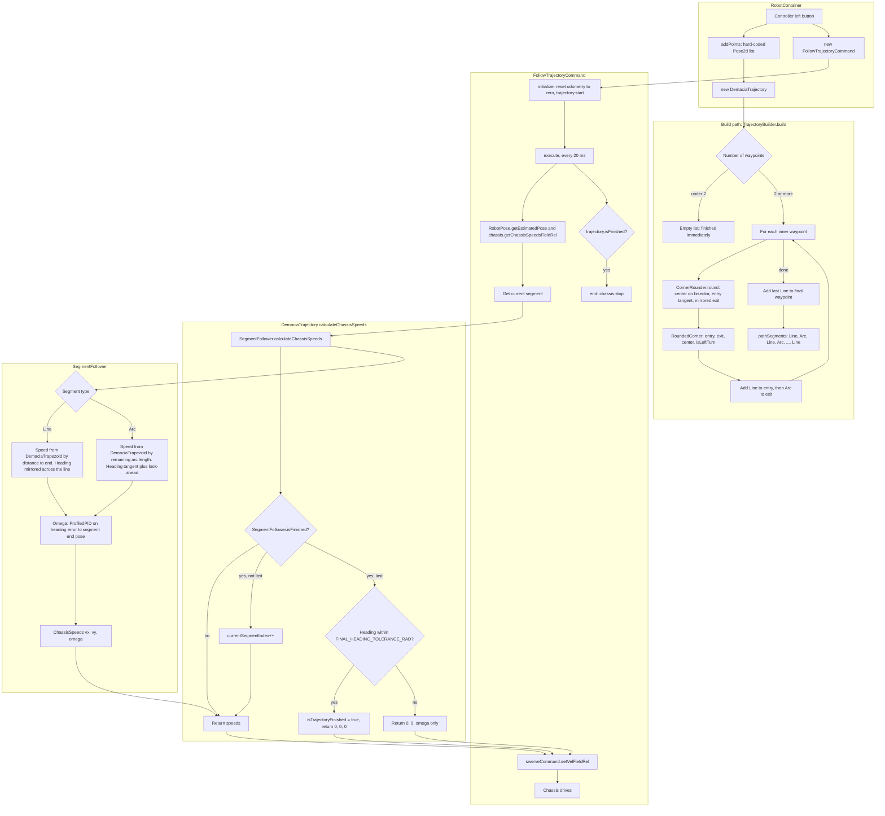
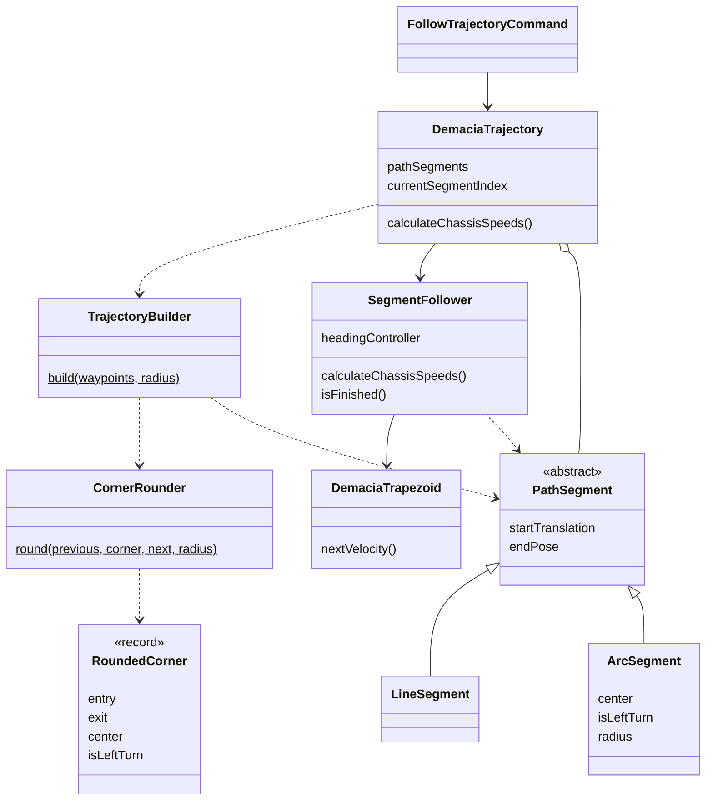

# Path code diagram

Overall flow of `frc.demacia.path`, from the button press to the swerve output.

Each class has one job, and data only moves forward:

1. **Build** (once): `TrajectoryBuilder` turns the waypoints into `Line, Arc, Line, ..., Line`.
2. **Follow** (every 20 ms): `DemaciaTrajectory` keeps the current segment and moves to the next one when it is done.
3. **Line / Arc logic**: `SegmentFollower` is the only class that knows the difference between a line and an arc.

## Segment-finished conditions (`SegmentFollower.isFinished`)

| Segment | Condition |
|---|---|
| Last line | Distance to end is below `FINAL_POINT_POSITION_THRESHOLD_METERS`. |
| Middle line | Distance to end is below `MID_PATH_POSITION_THRESHOLD_METERS`, or the end point has been passed (angle to end vs. line direction exceeds `MAX_ANGLE_TO_CONSIDER_POINT_PASSED_RAD`). |
| Arc | The velocity heading is within `MAX_HEADING_ERROR_TO_FINISH_ARC_RAD` of the exit tangent heading. |

## Folders

| Folder | Job |
|---|---|
| `DemaciaTrajectory` | Follows the list of segments, one after the other. |
| `builder/` | `TrajectoryBuilder`: waypoints to segments. |
| `geometry/` | `CornerRounder` + `RoundedCorner`: the math for one rounded corner. `TangentCalculator`: circle-to-circle helpers for later. |
| `segments/` | Data only: `PathSegment`, `LineSegment`, `ArcSegment`. |
| `following/` | `SegmentFollower` (line/arc speeds and finished check), `DemaciaTrapezoid` (velocity profile). |
| `commands/` | `FollowTrajectoryCommand`. |
| `constants/` | `PathConstants`. |

## Class structure

Arrows only go one way (top to bottom). `segments` uses no other path class.

